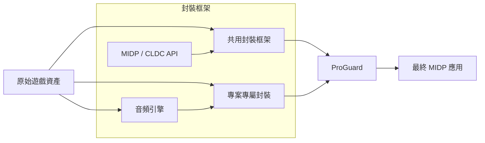

  
# RETRO J2ME

## ABOUT

RETROJ2ME 是一個規整自我封裝程式碼的 Organization。

這裡的封裝，是指把一些較為封閉的 J2ME API『翻譯』為國際化的 MIDP API。

現在，這裡只有 DoJa。未來會更加精彩。

## Core

### Docomo Core（DoJa/Star）

**[DoJa-to-MIDP-Core](https://github.com/RetroJ2ME/DoJa-to-MIDP-Core)**  
在個人的理解範圍內，對翻譯為 MIDP 的 DoJa API 進行了深度最佳化。

**[MLD PLyaer](https://github.com/Magstic/MLD_Player)**  
個人的一個獨立專案，專用於解碼 Docomo 的 MLD 旋律和採樣，它負責將 MLD 轉換為 MIDI 和 WAV，以供 MIDP 調用。

### Softbank Core（JSCL/VSCL/MEXA）

工事中……

### Willcom Core（AIR EDGE）

工事中……

### SKT（SK-VM）

工事中……

## Wrapper

## Docomo

| 作品 | 平臺 | 效能 | 地址 |
| :-- | :-- | :-- | :-- |
| 魔界塔士 Sa·Ga | DoJa | 真機，Heap 8MB | [GitHub](https://github.com/RetroJ2ME/SaGa_MIDP_Wrapper) |
| ワルキューレの栄光 | DoJa | 真機，Heap 8MB | [GitHub](https://github.com/RetroJ2ME/Valkyrie_MIDP_Wrapper) |
| 聖劍傳說 ～FF外傳～ | DoJa | 真機，Heap 2MB | [GitHub](https://github.com/RetroJ2ME/Mana_MIDP_Wrapper) |
| その兎、暴走。 | DoJa | 模擬器 | [GitHub](https://github.com/RetroJ2ME/Usatei_MIDP_Wrapper) |

## Technical 

圖是簡單的，但足以能一窺我的整套工作流。

題外話，毫不謙遜的說，這個架構經我手工設計，迭代數月。

即便程式碼是 Vibe，我也希望它能夠得到應有的尊重，而不是被所謂『古法至上』的偏見貶為垃圾。

## License

RetroJ2ME 各專案的原創程式碼依其所屬 Repository 中標示的授權條款提供。

若有採用 GNU General Public License version 3.0 的 Repository，其修改、編譯與重新散布均須遵守許可協議。

任何個人或第三方平台重新散布包含 RetroJ2ME GPLv3 程式碼的預編譯 JAR 檔案時，均須履行適用的 GPLv3 義務，包括：

- 向接收者提供 GPLv3 授權條款全文。
- 保留原有的著作權、授權及免責聲明。
- 依 GPLv3 第 6 節提供對應原始碼的取得方式。
- 如有修改受 GPLv3 保護的程式碼，須依授權條款標示修改資訊。

**第三方遊戲內容不屬於 RetroJ2ME 的 GPLv3 授權範圍**，原始遊戲的程式碼、美術、音效、音樂、商標及其他素材，其權利仍歸各自權利人所有。

RetroJ2ME 的開源授權不構成對這些內容的再散布許可。

相關授權條件請參閱各 Repository 的 `LICENSE` 檔案及 [GNU GPLv3 官方全文](https://www.gnu.org/licenses/gpl-3.0.html)。

---

Magstic 2026

